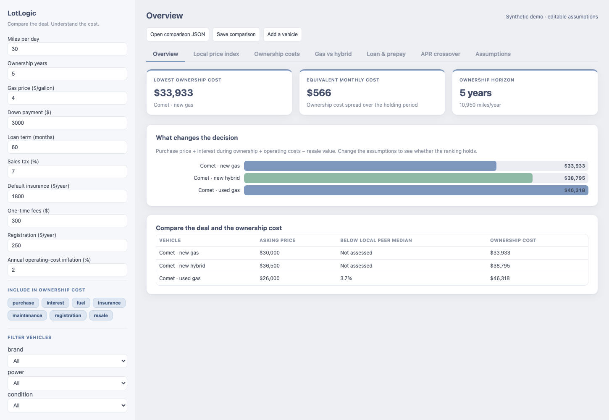
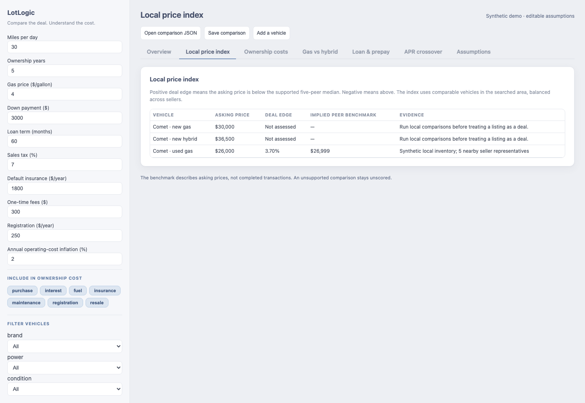

# LotLogic

Compare car deals by local market price and total cost of ownership.

A low asking price can be a good local deal and still be the more expensive purchase. LotLogic combines MarketCheck listing research with a seller-balanced local price index and an editable ownership model. Compare new and used cars, test whether a hybrid premium pays back, and see what financing, fuel, insurance, maintenance, and resale do to the result.



In this synthetic example, the used car starts $4,000 cheaper than the new car but costs more to own under the entered financing and operating assumptions. Change the mileage, rates, or resale estimates to test a different outcome.

## Start with your coding agent

Give Codex or Claude Code this instruction:

> Read AGENTS.md in this repository. Set up LotLogic on my Mac, show me the synthetic demo, then guide me through researching and comparing cars for my own purchase. Ask for my preferences and confirm any API spending before making live calls.

The agent installs the Python dependencies in a local environment, checks the setup, collects your buying criteria, researches vehicle assumptions, and prepares a comparison. The browser interface runs locally without a server or account. MarketCheck access is needed only for live listing research.

To try the demo yourself, open **web/index.html** in a browser or double-click **Open LotLogic.command**. The demo makes no network requests. Use **Save comparison** to retain edits and **Open comparison JSON** to restore them.

## Two different questions

**Is the asking price competitive?** The local price index compares a listing with five nearby peers in the searched inventory, balancing sellers and matching vehicle characteristics. A positive score means the ask is below the supported peer benchmark. Thin or incompatible comparisons remain unscored.



**What will it cost to own?** The ownership model combines the purchase price and taxes, interest incurred during the holding period, fuel, insurance, maintenance and repairs, registration, and expected resale. It also shows loan prepayment, the used-car APR that erases a new-car price advantage, and an explicit gas-versus-hybrid comparison. Each assumption can be changed, and each cost component can be included or excluded.

## Use your own research

The [setup guide](docs/setup.md) covers installation, live searches, shortlisting, and moving listing prices into the ownership comparison. The [model notes](docs/model.md) explain the formulas and local index. [Example files](examples/) show the input formats.

The existing research utilities include dealer and private-party search, incremental candidate tracking, trim/reference matching, Apple CarPlay classification, shortlist rebuilding, VIN lookup, and optional vehicle-history retrieval. Live results and credentials remain outside version control.

## Check the release

```sh
python3 -m venv .venv
.venv/bin/python -m pip install -r requirements.txt
.venv/bin/python tests/run_checks.py
```

The checks require Node.js for the JavaScript model tests. Optional browser verification uses Playwright and an isolated Chromium context:

```sh
.venv/bin/python -m pip install -r requirements-browser.txt
.venv/bin/python -m playwright install chromium
.venv/bin/python tests/test_browser.py
```

MIT licensed. This is a static release with no ongoing maintenance commitment.
